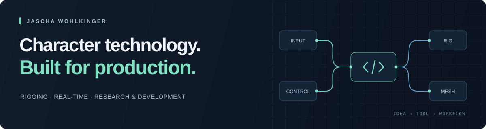

  

# Jascha Wohlkinger

### Senior Technical Artist | Character Technology & R&D

I specialize in character technology for real-time production, combining **rigging, deformation systems, pipeline engineering, and technical R&D**.

My work focuses on building scalable character solutions, developing production-ready tools, and exploring new approaches to animation and deformation through machine learning.

[Connect on LinkedIn →](https://www.linkedin.com/in/jascha-wohlkinger/) &nbsp; · &nbsp; [Explore my repositories →](https://github.com/JaschaW?tab=repositories)

## Areas of expertise

- **Character technology** — character rigging and deformation systems.
- **Tool development** — production tooling with Python and C++.
- **DCC & real-time** — Autodesk Maya and Unreal Engine.
- **Pipeline engineering** — character pipeline architecture and automation.
- **Research & development** — machine learning for character deformation.
- **Technical leadership** — cross-disciplinary collaboration.

## Public code

### [Turtle Killer](https://github.com/JaschaW/turtle_killer)

A Python utility for cleaning up Turtle-related nodes, plugin files, and shelves in Maya. Individual helper functions can also be used separately.

**Python · Autodesk Maya · Workflow utilities**

<strong>Rigging & deformation: community forks</strong>

These repositories are forks of community projects. Original authorship belongs to the linked upstream projects.

| Repository | Focus | Upstream |
| :--- | :--- | :--- |
| [mgear4](https://github.com/JaschaW/mgear4) | Maya rigging framework | [mgear-dev/mgear](https://github.com/mgear-dev/mgear) |
| [maya-transfer-blend-shape](https://github.com/JaschaW/maya-transfer-blend-shape) | Transfer blend shapes between meshes with matching topology | [robertjoosten/maya-transfer-blend-shape](https://github.com/robertjoosten/maya-transfer-blend-shape) |
| [SSDR-1](https://github.com/JaschaW/SSDR-1) | Smooth skinning decomposition with rigid bones in Maya | [dalton-omens/SSDR](https://github.com/dalton-omens/SSDR) |

---

Interested in character technology, production tools, or technical R&D? [Let's connect on LinkedIn.](https://www.linkedin.com/in/jascha-wohlkinger/)
