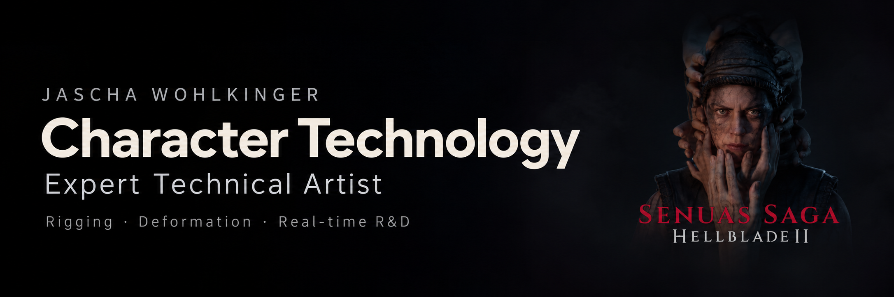

  

# Jascha Wohlkinger

### Expert Character Technical Artist | AAA Rigging, Deformation & Runtime Character Systems

**I build character technology that serves storytelling.**

I develop body and facial rigging, deformation systems, and runtime character workflows, connecting Maya tooling with Unreal Engine production.

On *Senua’s Saga: Hellblade II*, I was the sole technical artist responsible for the character pipeline, including body and facial rigging across the cast. My featured reel highlights the work developed for Senua.

I have also been a member of the [mGear development team](https://github.com/mgear-dev/mgear), contributing to the open-source rigging and animation framework for Autodesk Maya.

My R&D explores machine-learning-assisted deformation, ONNX inference in Maya, and procedural character workflows.

[Connect on LinkedIn →](https://www.linkedin.com/in/jascha-wohlkinger/)

## Featured work

### [Senua demo reel](https://vimeo.com/1079277404)

Character rigging and deformation work developed for Senua during the production of *Senua’s Saga: Hellblade II*.

[Watch the Senua reel →](https://vimeo.com/1079277404)

### [Machine learning for character deformation](https://www.linkedin.com/pulse/ml-project-dev-dairies-1-jascha-wohlkinger-3uvof)

A walkthrough of the data-generation and training tools behind my character deformation research.

[Read the ML dev diary →](https://www.linkedin.com/pulse/ml-project-dev-dairies-1-jascha-wohlkinger-3uvof)

## Areas of expertise

- **Character technology**: character rigging and deformation systems.
- **Tool development**: production tooling with Python and C++.
- **DCC & real-time**: Autodesk Maya and Unreal Engine.
- **Pipeline engineering**: character pipeline architecture and automation.
- **Research & development**: machine learning for character deformation.
- **Technical leadership**: cross-disciplinary collaboration.

---

Interested in character technology, production tools, or technical R&D? [Let's connect on LinkedIn.](https://www.linkedin.com/in/jascha-wohlkinger/)
